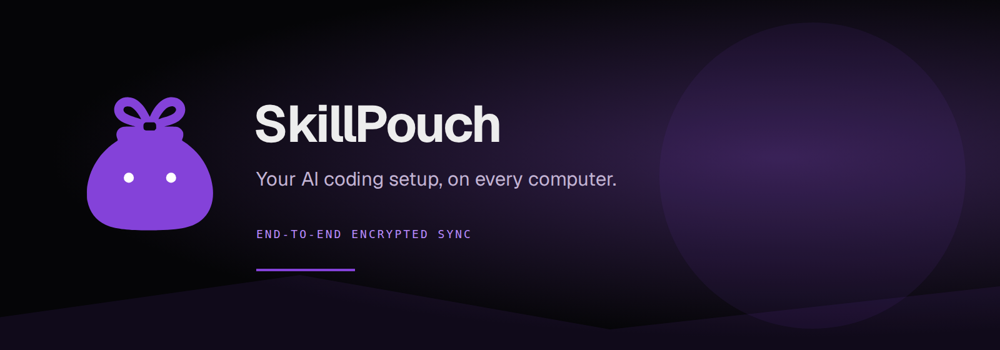
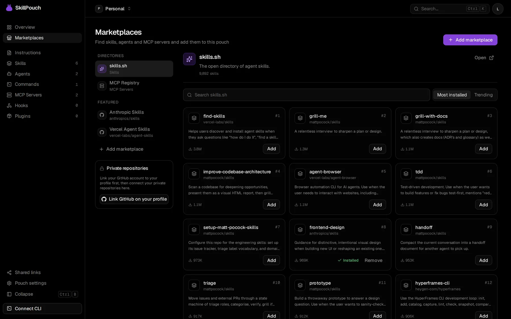

<div align="center">
  

  <p><strong>Your AI coding setup, on every computer.</strong><br />End-to-end encrypted sync for the tools and context that make your AI assistants yours.</p>

  <p><a href="https://skillpouch.net">Website</a> · <a href="https://app.skillpouch.net">Open the app</a> · <a href="https://discord.gg/u8eEJZEGhc">Discord</a> · <a href="https://github.com/skillpouch/skillpouch-cli">CLI repository</a></p>

  <p>
    <a href="https://github.com/skillpouch/skillpouch/blob/main/LICENSE"></a>
    <a href="https://github.com/skillpouch/skillpouch/actions/workflows/ci.yml"></a>
    <a href="https://discord.gg/u8eEJZEGhc"></a>
    <a href="https://skillpouch.net"></a>
  </p>
</div>

## Keep your setup together

Skills, agents, instructions, MCP servers, hooks and plugins tend to spread across assistants and computers. SkillPouch brings those pieces into one pouch and syncs them between your devices. Start free; paid plans add room.


## What you can sync

|                            | Included                                                                             |
| -------------------------- | ------------------------------------------------------------------------------------ |
| **Shared context**         | Skills, agent definitions, instructions and commands                                 |
| **Assistant connections**  | MCP server definitions, hooks, plugins and marketplace references                    |
| **More than one computer** | Keep your pouch in sync across the devices you connect                               |
| **Choose your setup**      | Select assistants and item kinds per computer; resolve simultaneous edits in the app |
| **Built for privacy**      | Content is encrypted on your device before it reaches the service                    |

The CLI currently detects Claude Code, Codex, OpenCode, Gemini CLI, Copilot CLI, Cursor, Windsurf, Qwen Code, Factory Droid and Crush. Exact item support and conversions vary by assistant. See the [CLI guide](https://github.com/skillpouch/skillpouch-cli) for details.



## How it works


The client encrypts pouch content before upload. The service stores and syncs ciphertext; it does not need plaintext to relay changes. Account keys, device membership and signed updates support access control and verification. This is not a claim that metadata or every operational detail is hidden: consult the [crypto package](packages/crypto) and threat-model notes in the source before evaluating it for sensitive environments.

## This repository

The web app and API live here; the native client has its [own repository](https://github.com/skillpouch/skillpouch-cli).

| Location             | Role                                                                  |
| -------------------- | --------------------------------------------------------------------- |
| `apps/api`           | Fastify API and background job worker                                 |
| `apps/web`           | React dashboard for pouches, devices, account and conflict resolution |
| `apps/site`          | Astro marketing site, deployed to Cloudflare Pages                    |
| `packages/crypto`    | Client-side cryptographic formats, keys and verification helpers      |
| `packages/contracts` | Shared API schemas and generated OpenAPI contract                     |
| `packages/db`        | PostgreSQL schema, migrations and row-level security                  |
| `deploy/`            | Docker Compose stack, Caddy, scripts and tunnel setup                 |

## Run it locally

Requirements: Node.js 24+, pnpm 10 and Docker.

```sh
pnpm install
cp apps/api/.env.example apps/api/.env
pnpm dev:db
pnpm db:migrate
pnpm dev
```

The dashboard runs at [localhost:5173](http://localhost:5173), API at [localhost:8080](http://localhost:8080), and marketing site at [localhost:4321](http://localhost:4321). Use the dashboard's development sign-in for local work. The root `pnpm dev` starts API, web and site together.

Useful scripts: `pnpm dev:api`, `pnpm dev:web`, `pnpm dev:site`, `pnpm build`, `pnpm typecheck`, `pnpm lint`, `pnpm test`, and `pnpm format:check`. See [package.json](package.json) for the full list.

## Self-hosting

The production stack and its operational requirements are documented in [`deploy/README.md`](deploy/README.md). It describes the Docker-based API, worker and PostgreSQL setup, secrets, backups and deployment flow. For external services see [`deploy/EXTERNAL-SERVICES.md`](deploy/EXTERNAL-SERVICES.md); Cloudflare Tunnel has a separate [guide](deploy/tunnel/README.md). Review the security and backup requirements before exposing an instance publicly.

## FAQ

**Can the service read my pouch?** Pouch content is encrypted client-side; the service relays and stores ciphertext. Protect your account credentials and recovery material, and review the cryptographic implementation before relying on it for a particular threat model.

**What if two computers edit the same item?** The CLI preserves a conflict copy and the app lets you choose which version to keep.

**Is it free?** You can start on the free plan. Paid plans add room; plan limits are visible in the app.

**Where is the command-line client?** In [`skillpouch-cli`](https://github.com/skillpouch/skillpouch-cli); install with `npm i -g skillpouch`.

## Contributing

Issues and pull requests are welcome. Install dependencies with pnpm, make focused changes, and run the relevant checks above. Contributions are accepted under the [Developer Certificate of Origin](https://developercertificate.org/); sign off commits with `Signed-off-by`.

## License

This repository is licensed under [AGPL-3.0-only](LICENSE).

<div align="center"><sub>Made for a calmer, more portable AI coding setup · <a href="https://skillpouch.net">skillpouch.net</a></sub></div>
